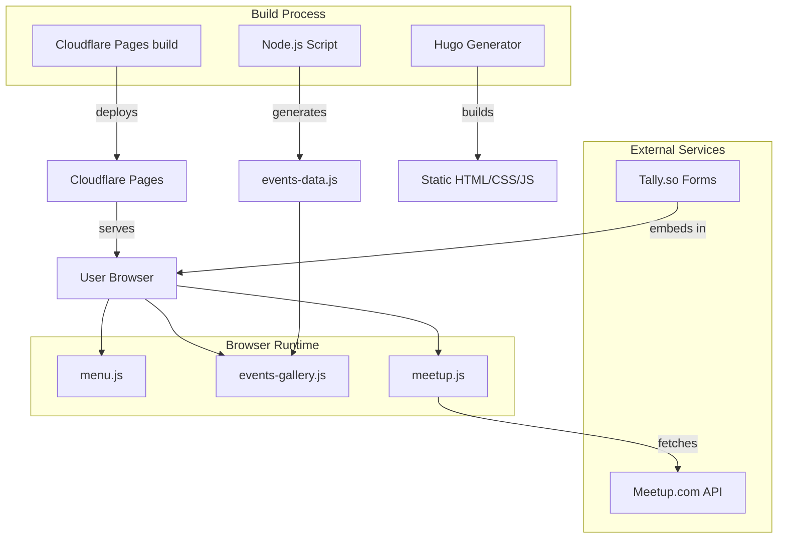
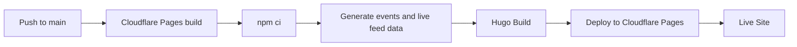
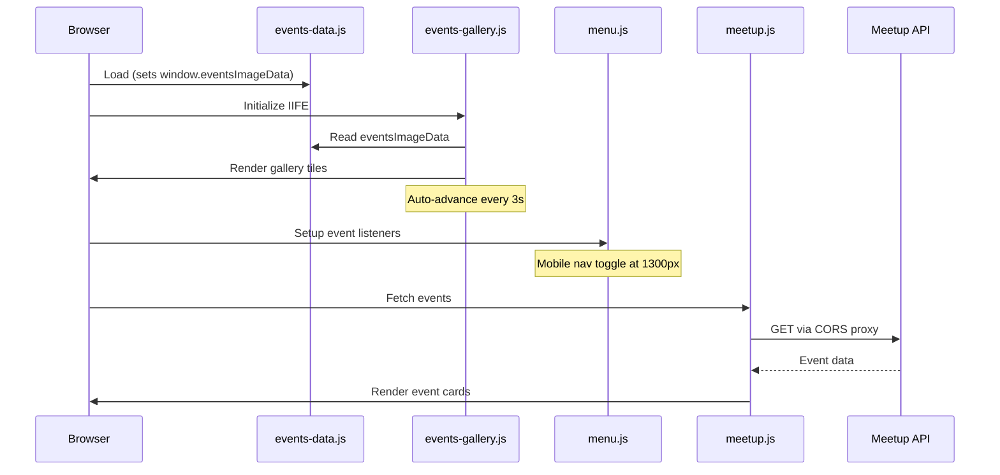

# C.O.D.E

[](https://gohugo.io/)
[](https://pages.cloudflare.com/)

**Your space to build.** A community-focused coding initiative bringing together developers, designers, and tech enthusiasts in the Philadelphia area.

## About

C.O.D.E is a welcoming community for anyone interested in technology, coding, and building projects. Whether you're a seasoned developer or just starting your journey, you'll find a supportive environment to learn, collaborate, and grow.

We host regular events including:

- **Weekend Coding Crew** - Casual coding sessions
- **LeetCode Practice** - Algorithm and interview prep
- **AI Paper Talks** - Discussions on latest AI research
- **Founder Fridays** - Coworking for entrepreneurs
- **Hackathons** - Build projects together
- **Web3 & ML Workshops** - Learn emerging technologies

## Features

- **Blog Platform** - Tech tutorials, event recaps, and community stories
- **Events Carousel** - Rotating display of upcoming community events
- **Meetup Integration** - Live event data from Meetup.com
- **Tech Talent Matchboard** - Connect job seekers with opportunities
- **Event Sponsorship** - Support our community events

## Quick Links

| Resource | Link |
| ---------- | ------ |
| Live Site | [codephilly.com](https://www.codephilly.com/Code-And-Coffee-philidelphia-Website) |
| Meetup Group | [C.O.D.E](https://www.meetup.com/code-and-coffee-philadelphia/) |
| Merch Store | [Fourth Wall Shop](https://nol-kky-shop.fourthwall.com/) |
| Community Fund | [Givebutter](https://givebutter.com/c_o_d_e) |

## Tech Stack

| Category | Technology |
| ---------- | ------------ |
| Static Site Generator | [Hugo](https://gohugo.io/) v0.126.1 |
| Hosting and CDN | [Cloudflare Pages](https://pages.cloudflare.com/) |
| CSS Framework | [PureCSS](https://purecss.io/) |
| Forms | [Tally.so](https://tally.so/) |
| Fonts | Google Fonts (Vollkorn, Gloria Hallelujah, Space Mono) |

## Architecture Overview



## Getting Started

### Prerequisites

- [Hugo](https://gohugo.io/installation/) v0.126.1 or later (extended version)
- [Node.js](https://nodejs.org/) v20 or later
- Git

### Installation

```bash
# Clone the repository
git clone https://github.com/your-username/Code-And-Coffee-philidelphia-Website.git
cd Code-And-Coffee-philidelphia-Website

# Generate events data (required before first build)
node scripts/generate-events-data.js

# Start development server
hugo server --bind 0.0.0.0 --port 5000 --baseURL http://localhost:5000
```

### Full Development Build

```bash
# Clean build with events data regeneration
rm -rf public && node scripts/generate-events-data.js && hugo server --bind 0.0.0.0 --port 5000 --baseURL http://localhost:5000
```

Quick version (does the same thing): `npm start`

### Production Build

```bash
node scripts/generate-events-data.js && hugo --gc --minify --cleanDestinationDir --forceSyncStatic
```

To run a local test copy of the prod build use: `npm run prod`

## Build & Deployment Pipeline



Cloudflare Pages builds the site from this repository. Every push to `main` triggers:

1. Installation of Hugo v0.126.1 and Node.js 20, set by the `HUGO_VERSION` and `NODE_VERSION` build variables
2. Events and live feed data generation
3. Hugo build with minification
4. Deployment to Cloudflare Pages

The `hugo.yml` workflow calls the project's deploy hook every day at 10:17 UTC to refresh the Tech Pulse data. The hook URL is stored in the `CLOUDFLARE_PAGES_DEPLOY_HOOK` repository secret.

## Content Operations

### Adding a Blog Post

1. Create a new folder in `content/blog/`:

   ```bash
   mkdir content/blog/my-new-post
   ```

2. Create `index.md` with front matter:

   ```yaml
   ---
   title: "My New Post Title"
   date: 2025-01-17
   author: "Your Name"
   description: "Brief description of the post"
   featured: false
   topic: "JavaScript"
   tags:
     - javascript
     - tutorial
   image: "/images/optional-hero.jpg"
   ---

   Your markdown content here...
   ```

3. Commit and push to `main` branch

### Adding an Event Image

1. Add your image to `static/images/events/`
   - Supported formats: `.jpg`, `.jpeg`, `.png`, `.svg`, `.webp`
   - Filename becomes display name (e.g., `AI_Paper_Talks.jpg` → "AI Paper Talks")

2. The build script auto-generates `events-data.js` during deployment

### Updating Community Links

Edit `content/links/index.md` to add or modify community resource links.

### Embedding a Tally Form

Add an iframe in your markdown:

```html
<iframe src="https://tally.so/embed/YOUR_FORM_ID" width="100%" height="500" frameborder="0"></iframe>
```

## Project Structure

```text
├── content/
│   ├── _index.md              # Homepage
│   ├── blog/                  # Blog posts (page bundles)
│   ├── links/                 # Community links page
│   └── event-sponsorship/     # Sponsorship form
├── layouts/
│   ├── _default/
│   │   ├── baseof.html        # Base template
│   │   ├── list.html          # Blog listing
│   │   └── single.html        # Individual post
│   └── partials/              # Reusable components
├── static/
│   ├── css/                   # Stylesheets
│   ├── js/                    # JavaScript modules
│   └── images/events/         # Event gallery images
├── scripts/
│   └── generate-events-data.js # Build script
├── hugo.toml                  # Hugo configuration
└── CLAUDE.md                  # AI assistant guidance
```

## JavaScript Modules



| Module | Purpose |
| -------- | --------- |
| `menu.js` | Responsive mobile navigation toggle (breakpoint: 1300px) |
| `events-gallery.js` | Events photo grid (one tile per image) |
| `meetup.js` | Fetches live events from Meetup.com via CORS proxy |
| `events-data.js` | Auto-generated event data from image filenames |

## Contributing

We welcome contributions! Here's how to get involved:

1. **Fork** the repository
2. **Create** a feature branch (`git checkout -b feature/amazing-feature`)
3. **Commit** your changes (`git commit -m 'Add amazing feature'`)
4. **Push** to the branch (`git push origin feature/amazing-feature`)
5. **Open** a Pull Request

### Code Style

- **CSS**: Use CSS custom properties (variables) defined in `static/css/modern.css`
- **JavaScript**: Vanilla JS, IIFE pattern for modules
- **Hugo**: Follow existing template patterns in `layouts/`

### Pull Request Checks

Every pull request targeting `main` runs the documented GitHub Actions validation checks in `.github/workflows/`. Before opening a PR, run `npm run generate:data`, `npm run validate`, and `npm test` locally when your change touches content, data, scripts, templates, or generated static data. PR checks also build the Hugo site, run end-to-end smoke tests, guard against root-relative asset paths that break project-page deployments, and check internal links in the generated output.

CodeRabbit is installed for this repository and reviews PRs using `.coderabbit.yaml`. It focuses on static-site safety, Hugo templates, content/front matter quality, responsive CSS, browser JavaScript, GitHub Actions, secrets checks, and accessibility-impacting changes. If automatic reviews are paused and an existing PR needs a fresh review, comment `@coderabbitai review`; incremental reviews do not revisit commits that CodeRabbit has already reviewed.

## Community

- **Meetup**: [C.O.D.E](https://www.meetup.com/code-and-coffee-philadelphia/)
- **Website**: [codephilly.com](https://www.codephilly.com/Code-And-Coffee-philidelphia-Website)

Join us for events, ask questions, and connect with fellow developers!

## License

This project is open source and available for community use.

---

Built with caffeine and code by the C.O.D.E community.
