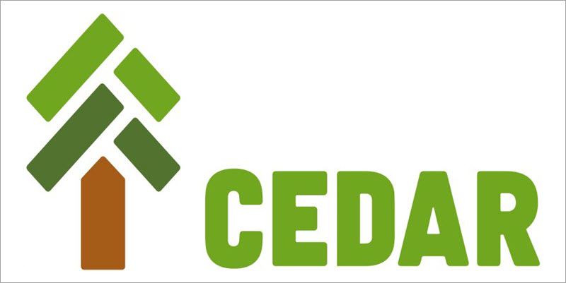

# Exploring Lambda Layers and Cedar Policies in AWS

## Introduction

I’m always looking for ways to **automate security enforcement** while keeping things **scalable and reusable**. One of my recent experiments involved **Lambda Layers and Cedar Policies**—two powerful tools that allow for **centralized management** and **fine-grained authorization** in AWS.

In this post, I’ll take you through one of my **first tests** with Cedar, the challenges I faced, and how I'm evolving my implementation into a **more scalable and reusable** solution. Along the way, I'll discuss how **Lambda Layers can be used to control permissions in API Gateway endpoints dynamically**, reducing complexity while improving security. I'll also cover **why this approach matters**, a few implementation details, considerations, and possible future improvements.

---

## What Are Lambda Layers?

I have to smirk as I write this, recalling a recent code-and-coffee meetup where someone was genuinely excited to hear others were actually using Lambda Layers! AWS **Lambda Layers** allow you to package **dependencies, libraries, and custom logic** separately from your Lambda functions. Instead of embedding the same logic in every function, you can create a **shared layer** that multiple Lambda functions reference.

### Why Use Lambda Layers?

- **Reduce duplication** – Store common code separately to avoid repeating logic.
- **Improve security** – Centralize policy management to prevent inconsistencies.
- **Simplify deployment** – Update shared dependencies independently.
- **Improve performance** – Smaller packages mean faster cold starts.
- **Easier maintenance** – Update code once, reuse everywhere.

### Lambda Layer Structure

Here’s how I structured my Lambda Layer (the folder is actually called 'Permissions'):

```plaintext
permissions-layer/
├── cedar_policies/
│   ├── identity.user.management.cedar
│   └── vulnerability.nvd.management.cedar
├── python/
│   └── cedar_policy_loader.py
└── requirements.txt
```

---

## Lambda Layer Script: `cedar_policy_loader.py`

The `cedar_policy_loader.py` script lives inside the Lambda Layer. Its job is to dynamically load the correct Cedar policy based on the incoming API Gateway request and authorize the request using the policy.

### Detailed Breakdown

Here's the full script with thorough comments:

```python
import os
from cedarpy import is_authorized
from datetime import datetime

# Directory holding Cedar policy files
POLICY_DIR = os.path.join(os.path.dirname(__file__), "../cedar_policies")

def get_current_millis():
    """Get the current time in milliseconds for time-based policy checks."""
    now = datetime.now()
    return now.hour * 60 * 60 * 1000 + now.minute * 60 * 1000 + now.second * 1000

def load_policy(policy_name):
    """Loads Cedar policy files based on the provided policy name."""
    policy_path = os.path.join(POLICY_DIR, f"{policy_name}.cedar")
    try:
        with open(policy_path, 'r') as file:
            return file.read()
    except FileNotFoundError:
        raise Exception(f"Policy '{policy_name}.cedar' not found in the policy directory.")

def check_authorization(policy_name, principal, action, resource):
    """Checks if the provided principal is authorized based on the policy."""
    policy = load_policy(policy_name)
    request = {
        "principal": principal,
        "action": action,
        "resource": resource,
        "context": {"time": get_current_millis()}
    }
    return is_authorized(request, policy, []).allowed
```

### How It Works

1. Retrieves current time for policies with time conditions.
2. Dynamically loads the Cedar policy based on API path.
3. Evaluates authorization against Cedar policies.

---

## Example Cedar Policy File (`identity.user.management.cedar`)

Here's a concrete example of a Cedar policy, which also demonstrates role-based and time-based access control:

```rust
permit(
    principal in [Group::"Admin", Group::"PowerUser"],
    action in [Action::"create", Action::"update", Action::"delete"],
    resource == Identity::"UserManagement"
);

permit(
    principal == Group::"SupportStaff",
    action == Action::"read",
    resource == Identity::"UserManagement"
)
when {
    // Allow read access only during business hours (8 AM - 6 PM UTC)
    8 * 60 * 60 * 1000 < context.time &&
    context.time < 18 * 60 * 60 * 1000
};
```

### Why This Example?

- Admins and Power Users get full CRUD access.
- Support Staff have read-only access, limited to business hours.

---

## How Does API Gateway Determine the Policy Filename?

API Gateway endpoints directly determine which policy file to load. For instance:

- Endpoint `/identity/user/management` maps directly to `identity.user.management.cedar`
- Endpoint `/vulnerability/nvd/lookup` maps to `vulnerability.nvd.management.cedar`

This mapping logic is straightforward, making adding policies as simple as dropping a file into the policy directory.

---

## Example Lambda Function Integration

Here's how your Lambda handler integrates with the Cedar policy loader layer:

```python
import json
from cedar_policy_loader import check_authorization

def lambda_handler(event, context):
    """API Gateway handler that dynamically authorizes requests using Cedar policies."""

    # Extract API request path (used to load correct policy)
    request_path = event['resource']

    # Dynamically convert API path into a policy filename
    policy_name = request_path.strip("/").replace("/", ".")

    # Retrieve user role from authorizer context
    principal = event['requestContext']['authorizer']['lambda']['user-role']

    # Map HTTP method to Cedar actions
    action = event['httpMethod']

    # Extract resource ID, default to generic resource if not provided
    resource = event.get('queryStringParameters', {}).get('resource', "API::Default")

    # Perform Cedar policy-based authorization check
    if not check_authorization(policy_name, principal, action, resource):
        return {"statusCode": 403, "body": json.dumps({"message": "Not authorized."})}

    # Authorized request, proceed with business logic
    return {"statusCode": 200, "body": json.dumps({"message": "Access granted!"})}
```

---

## How Do You Attach a Layer in CloudFormation?

### Step 1: Define the Lambda Layer

```yaml
CedarPolicyLoaderLayer:
  Type: AWS::Serverless::LayerVersion
  Properties:
    LayerName: cedar-policy-loader-layer
    Description: Layer for Cedar policy loader
    ContentUri: src/layers/permissions
    CompatibleRuntimes:
      - python3.8
      - python3.9
      - python3.10
```

### Step 2: Attach Layer to Lambda Function

```yaml
IdentityUserManagementFunction:
  Type: AWS::Serverless::Function
  Properties:
    Handler: user_management.lambda_handler
    CodeUri: src/identity/
    Policies:
      - AWSLambdaBasicExecutionRole
    Layers:
      - !Ref CedarPolicyLoaderLayer
    Events:
      UserManagement:
        Type: HttpApi
        Properties:
          ApiId: !Ref HttpApi
          Path: /identity/user/management
          Method: post
    Environment:
      Variables:
        DYNAMODB_TABLE_NAME: !Ref UserTableName
```

### How It Works

- The Lambda Layer is defined separately.
- Lambda functions reference the Layer via CloudFormation.
- Each Lambda gains access to shared Cedar policy-loading logic.

---

## Using `cedarpy` for Cedar Integration

I leveraged [`cedarpy`](https://github.com/k9securityio/cedar-py) to integrate Cedar's Rust-based policy engine into Python, allowing:

- Authorization checks directly from Python.
- Efficient batch authorization.
- Easy policy formatting and validation.

Install it easily in your project with:

```bash
pip install cedarpy
```

---

## Review and Future Improvements

By combining Lambda Layers and Cedar Policies hopefully I've shown you a solution that is:

- Dynamic and consistent policy enforcement.
- Centralized management and scalable deployments.
- Reduced complexity in security management.

### Future enhancements include:

- More sophisticated conditions and role-based permissions.
- Integration of AWS IAM with Cedar policies.
- Improved Lambda performance through optimized layers.
- Enhanced logging and security monitoring.

---

## Closing Remarks

Lambda Layers and Cedar Policies together enable a unique method for access control that I think provides a secure, maintainable, and efficient approach for API authorization. Automating policy enforcement reduces manual overhead, limits risk, and scales smoothly.

Thanks to `cedarpy`, integrating Cedar's robust Rust engine into Python is a bit more straightforward, giving a powerful option to secure AWS dynamically.

**What do you think about this approach? This was my first go at something unique so id like to know how you think this solution could be improved **
