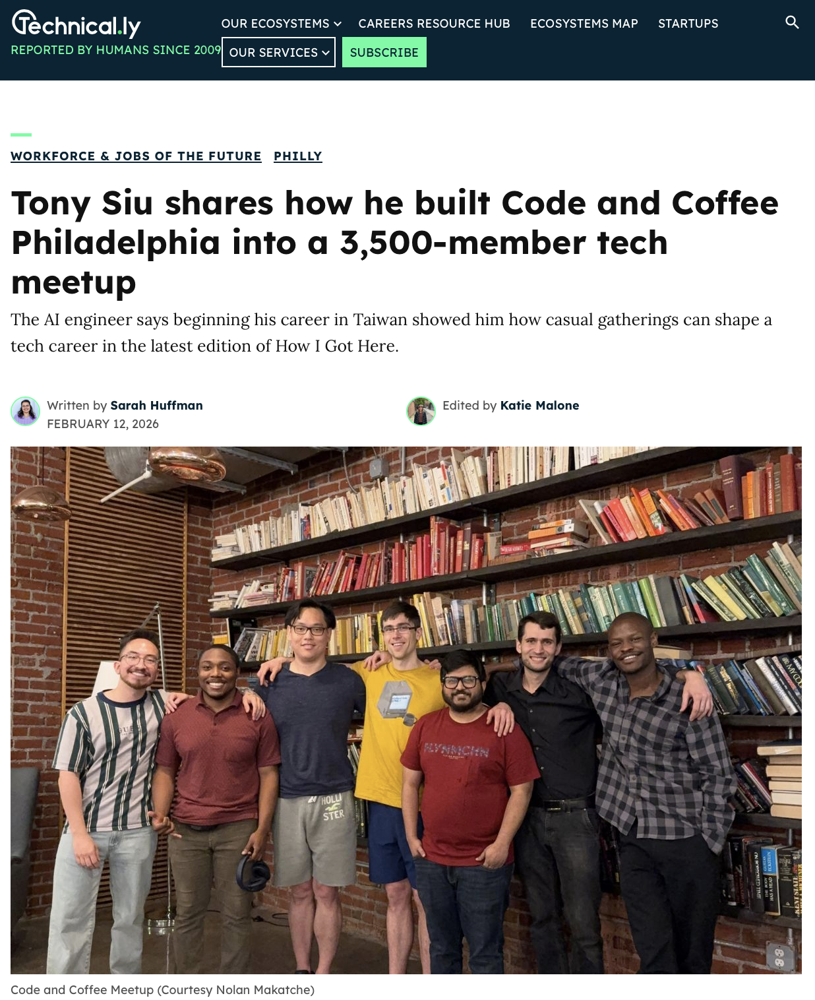

Technical.ly published a profile on Tony Siu, founder of Coffee and Code Philadelphia, as part of their "How I Got Here" series.

<!--more-->

## The Story

Tony Siu, an AI engineering consultant, founded Coffee and Code Philadelphia in 2024. The meetup has since grown to over 3,500 members with multiple weekly events and recently hosted its first pitch competition with Pennovation Works.

Originally from Hong Kong, Siu moved to Taiwan in 2019 where he taught himself to code through coffee shop meetups and technology gatherings in Taipei. He eventually landed positions as a computer vision engineer and research lead at Google University Research.

After a stint working for a16z Speedrun in the Bay Area — where he learned that startup success depends heavily on communication and presentation skills alongside technical merit — Siu moved to Philadelphia.

## On Philly's Tech Scene

Siu notes that Philadelphia's tech ecosystem has strong talent but is risk-averse. "The talent here is a lot more scrappy," he observes, and "finds different and creative ways to get things done."

He created Coffee and Code to replicate the collaborative, casual atmosphere he experienced in Taiwan's meetup scene — fostering community among engineers from diverse backgrounds and expertise levels.

The organization is working toward formal nonprofit status.

Read the full article on Technical.ly:

**[How Tony Siu built Philly's 3k+ member Coffee and Code meetup](https://technical.ly/workforce/tony-siu-code-and-coffee-how-i-got-here/)**
